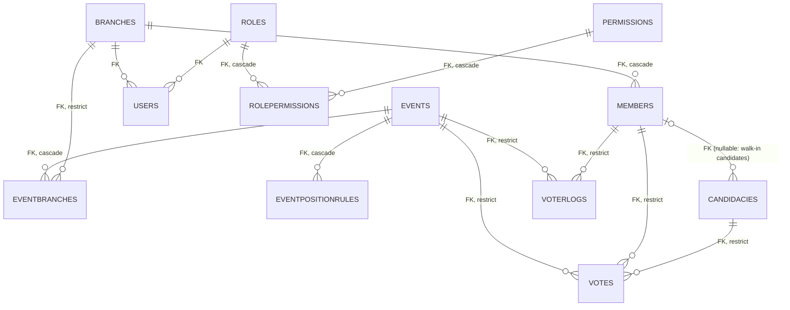
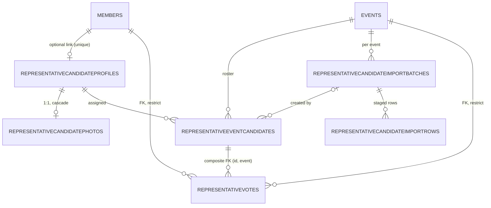

# 01 — Source and database audit, architecture report and design

Part 2 of the engineering task: audit first, then build. This document records what the **original** system did (so the claims can be checked against the code),
the findings that shaped the design, and the design itself. It contains no data from any installation: only code facts and schema facts.

## 0. Scope, sources and method

| Source | What was read | How |
|---|---|---|
| API repository, base commit `0b5a180` (= `main` before this work) | Controllers, services, entities, `Program.cs`, migrations | `git show 0b5a180:<path>`; every statement about "the original" below can be re-checked that way |
| `EVoting.Admin.zip` (WPF desktop application, supplied) | View models, services, exports, XAML | read-only copy; changes are listed in the Admin change summary delivered with the Admin package |
| Schema of the supplied MySQL 8.0 dump | `CREATE TABLE` statements, keys, foreign keys, indexes | schema only; row data is not reproduced in any document |
| Kiosk application (separate repository `EVoting.Kiosk`) | its API calls, local cache and offline queue | **read-only**, to derive the contract; not modified, not built here |

Not available: a production database, the Registration Station source (only its API calls appear in the API controllers), real kiosk hardware.

## 1. Existing architecture (audit item 1)

```
 Kiosk (WPF tablet, offline cache)   Registration Station        Admin (WPF desktop)
        │  JWT role Kiosk / Voter           │  JWT role Registration       │  JWT role Admin + permission codes
        └───────────────┬────────────────────┴──────────────────────────────┘
                        ▼
        EVoting.Api  (ASP.NET Core, net9.0)  ── SignalR hub /hubs/election (groups: kiosk, admin, registration)
          Controllers → Services → ApiDbContext (EF Core 9, Pomelo MySQL)
          Hosted service: VotingSchedulerService (checks every 10 s)
          Distributed cache (Redis when configured, otherwise in-memory) · rate-limit policies · health checks
                        ▼
                  MySQL 8.0  (schema managed by EF migrations)
```

| Concern | How the original did it |
|---|---|
| Authentication | JWT bearer. Roles `Admin`, `Kiosk`, `Voter` (short-lived, bound to one member and one event; 30 minutes in the shipped configuration) and `Registration`. |
| Authorisation in Admin | `[RequirePermission(...)]` filters on every admin action; permissions are rows (`Permissions`, `RolePermissions`) so each role gets its own set. |
| Admin vs. voting endpoints | `api/v1/admin/...` (permissioned) and `api/v1/events`, `api/v1/votes`, `api/v1/auth` (role-gated). |
| Concurrency on a ballot | `RepeatableRead` transaction and a `SELECT … FOR UPDATE` on the voter's `voterlogs` row (§5). |
| Event state | `EventStateService` under one process-wide semaphore (`Gate`): at most one election is `Opened`; changes evict the cached "current event" and push `EventStatusChanged` over SignalR. |
| Schedule | `VotingSchedulerService` opens a `Closed` event inside its window and closes an `Opened` one after `ScheduleTo` (10-second tick), unless an administrator closed it by hand (`AutoOpenGuard`). Times are election wall-clock time, UTC+8. |
| Rate limiting | policies `vote`, admin/kiosk/station login, voter verify (values from configuration). |
| Audit | `IAuditService.Stage(...)` inside the same `SaveChanges` as the change it describes; `AuditLogs` has no foreign keys. |

## 2. Database relationships (audit item 2)

Fourteen tables in the audited schema: `__efmigrationshistory`, `auditlogs`, `branches`, `candidacies`, `eventbranches`, `eventpositionrules`, `events`, `members`,
`permissions`, `rolepermissions`, `roles`, `users`, `voterlogs`, `votes`. Foreign keys as found:



Three structural facts matter for what follows:

1. **`candidacies` has no `EventId`.** It is a global list of filings; the link to an election is made at read time (§4).
2. **`votes.CandidacyId` is a foreign key to `candidacies`.** A Representative candidate cannot be stored there without turning every Representative candidate into a General Assembly filing.
3. **`votes` and `voterlogs` are `RESTRICT` everywhere**, `events → eventbranches/eventpositionrules` are `CASCADE`. Submitted election records are never cascade-deleted today; the new tables keep that rule.

Unique keys that existing code relies on: `members.AccountCode`, `users.Username`, `voterlogs (MemberId, EventId)`, `votes (MemberId, EventId, CandidacyId)`.
`eventpositionrules` had **no** unique key on `(EventId, Position)`; the audit looked for duplicates before the key was added (`03-migration-review.md` §5).

The new tables and columns are in the ER diagram of §11 and described column by column in `03-migration-review.md`.

## 3. Event creation flow (audit item 3)

`POST /api/v1/admin/events` (`EventsAdminController.Create`, permission `EVENT_ADD`):

1. Validate: title and venue present; `ScheduleTo` after `ScheduleFrom`; at least one branch and every branch exists and is active; the title is unique among active events; and **no two active events may have overlapping
   schedule windows** (`409 SCHEDULE_CONFLICT`, because only one election can be open at a time). These rules are shared by both event types.
2. In one transaction: insert the event with `Status = "Closed"` (the scheduler or an administrator opens it later), insert one `EventBranches` row per branch, insert the four default
   position rules (`DefaultPositionRules.All`), stage the audit row, commit.
3. `PUT` keeps existing rules (it used to delete and re-seed them; fixed before this work) and refuses a change of the branch list while the event is `Opened` (`EVENT_OPEN_LOCK`).
4. `POST …/open` and `…/close` go through `EventStateService`; `DELETE` is refused when ballots exist unless `purgeVotes=true`.

There was **no event type**: every election was a General Assembly election with the four default rules, and its candidates came from the global list (§4).

## 4. General Assembly candidate flow (audit item 4)

* Admin maintains **`candidacies`** (`CandidaciesAdminController`: list, filter, create, edit, delete, approve/reject, photo). While an event is `Opened`, every candidacy write is refused (`EVENT_OPEN_LOCK`).
* A candidate is a member (`MemberId`) or a walk-in (`WalkInCandidateName`); `Status` is `Pending`/`Approved`/`Rejected`; the photo is a `byte[]` column on the same row.
* **An election has no candidate list of its own.** `GET /events/{id}/candidates` returns every candidacy that is `Approved`, active, and whose approval date (filing date when none) is on or after
  **180 days before the event's `ScheduleFrom`**; ordered by position, then name; photos inlined as Base64; cached for a short time.
* Position rules tell the kiosk how many to pick: `MinVotes`, `MaxVotes`, `TotalSeats` per position.

Consequence for the design: this is workable for a few dozen candidates but cannot express "these 900 candidates, at these positions, in this election only". The Representative election therefore gets its own roster (§11).

## 5. Vote submission flow (audit item 5)

`POST /api/v1/votes` (role `Voter`, rate-limited):

1. The voter's JWT carries `memberId` and `eventId`; the body's `eventId` must match.
2. If the kiosk sends its own receipt code (`EVT{event}-{8 hex}-{8 hex}`, validated by `ReceiptCodeFormat`) the cast is **idempotent** (a repeat answers "already recorded"). Without one, the original path generates the code.
3. `VoteService`: begin `RepeatableRead`; `SELECT … FROM voterlogs WHERE MemberId=? AND EventId=? FOR UPDATE`; refuse when `HasVoted`; load the event (active); check the online window
   (`Opened`, schedule start ≤ now < schedule end, election time UTC+8); validate the selections (the event must have valid position rules, no candidacy twice, every candidacy `Approved`, active and inside the 180-day window,
   its position equal to the submitted position, and for **every** configured position the count between `MinVotes` and `MaxVotes`, so omitting a position from the payload does not skip it); insert one `votes` row per selection and the
   `voterlogs` row (or flip it to `HasVoted`); commit.
   A deadlock is retried a few times.
4. After commit the API pushes a dashboard refresh and a `MemberVoted` message (fire-and-forget).

Voter verification (`POST /auth/voter-verify`) requires, in this order: an `Opened` active event; an active member with that account code; `IsEligibleToVote` (else `422`); a member branch that participates in the event (else `403`);
and no completed vote (else `409`).

## 6. Offline sync flow (audit item 6)

* The kiosk downloads the **member snapshot** at start (`GET /events/{id}/member-snapshot`: every active member with `IsEligible` = `IsEligibleToVote` **and** branch participates), the rules and the candidates, and caches them locally.
* Offline it verifies from the snapshot, records a ballot in a local queue with its own receipt code and the cast time, and later posts it to `/votes/offline-sync` (one) or `/votes/offline-sync-bulk` (many).
* `CastOfflineVoteAsync` uses the same row lock; a repeat with the **same** receipt code answers "already processed" (safe retry), a different code for a member who already voted is rejected; the cast time
  must not be in the future (beyond a small clock-skew tolerance) and must fall inside the event's window.
* The bulk endpoint always answers 200 with one result per ballot; `isPermanentRejection` tells the kiosk which ballots to stop retrying.

The original classifies only `InvalidOperationException` as permanent; an `ArgumentException` (some rule violations) is reported as retriable. That is a General Assembly behaviour that was **not changed**; Representative ballots are classified separately (`RepresentativeHttp.IsPermanent`).

## 7. Eligibility computation (audit item 7)

* A member's eligibility is a **stored flag**: `Members.IsEligibleToVote` and `VotingRemarks`, written when a member is created, edited or imported.
* The rule: `ShareCapital ≥ MinShareCapital` **and** `SavingsDeposit ≥ MinSavingsDeposit` **and** `LoanStatus ≠ PastDue`. The two thresholds came from `appsettings.json` (`Eligibility:*`, default 3000 / 4000).
* Everybody consumes the **flag**: voter verification, online and offline casting, the kiosk snapshot, voter lookup, the registration roster.
* The legacy Admin application carried its own copies of the rule (the editor preview and the import preview used different numbers from the API); the API is now the single authority.

Consequence: changing a threshold means recomputing the flag for every member, and the flag must not change while ballots are being cast. `06-eligibility-policy.md` records that design.

## 8. Voter lookup implementation (audit item 8)

`GET /api/v1/admin/voter-lookup` (`AdminController.VoterLookup`, permission `EVENT_VIEW`), as found:

* Loaded **every** `voterlogs` row of the event, and **every** eligible active member of the event's branches **including the photo column** (`Include(Branch)` on the full entity), into memory.
* Applied the "voted / not voted" filter and `Skip/Take` **in memory** after materialising everything; `total` was a count of the in-memory list.
* The search was `LIKE '%text%'` on name, account code and (through a correlated subquery) receipt code.
* Default page size 100 (clamped to 1–500); a page below 1 was not rejected.
* Result: cost and memory grew with the size of the electorate, not with the size of the page.

`06-voter-lookup-paging.md` records the replacement: three bounded statements (a count; one page of member ids in name order; the rows of those ids and their voter-log rows), no wide columns read, conditions sent in a form MySQL can
answer from an index, a bounded receipt look-up that is skipped when the typed text cannot be part of a receipt code, and two indexes added as a performance aid.

## 9. Manage Candidates export / import (audit item 9)

* **Export** exists: `GET /admin/candidacies/export` returns the filtered rows as JSON (capped at 20,000 rows, 1,000 with photos; `X-Export-Truncated` when cut), and the Admin builds the workbooks
  ("All data", by position, approved only, pending only).
* **Candidate import does not exist.** The Admin menu has "Download import template" — a blank workbook (sheets *Template* and *Instructions*; columns `AccountCode, Position, CellNo, TelNo, CivilStatus, Gender,
  DateOfBirth, HighestEducation, PreviousPositions, SpecialSkills, Reason`) — but nothing reads a filled-in candidate file. The imports that do exist are for **members** and **users**, both with a server-validated preview before the commit.
* Hence the Representative import (`02-import-and-column-mapping.md`) is new code following the same *preview → confirm* pattern, with its own staging tables.

## 10. Findings that shaped the design

| # | Finding in the original | Design consequence |
|---|---|---|
| F1 | Candidates are global; the election is picked by a 180-day date window | A Representative election gets an explicit per-event **roster** table. GA is untouched. |
| F2 | `votes.CandidacyId` references `candidacies` | Representative ballots get their **own votes table**; no change to `votes`. |
| F3 | `EventPositionRules` had no unique key and seeded the same four GA positions for every event | New key `(EventId, Position)`; defaults are seeded for **General Assembly events only**; a Representative event defines its own rules. |
| F4 | Eligibility is a stored flag with configuration-only thresholds | Thresholds become editable settings with an audit trail, a recompute, and a rule that they cannot change while an election is open. |
| F5 | Voter lookup materialised the electorate in memory | Server-side paging with a covering index, bounded search, constant memory. |
| F6 | The kiosk caches the member snapshot, rules and candidates and votes offline | Representative contract is additive and versioned (roster fingerprint); GA contract frozen and verified by a differential run. |
| F7 | No candidate import existed | New staged, validated, idempotent import with explicit confirmation. |
| F8 | Only one election is `Opened` at a time; both the manual path and the scheduler open events | One shared readiness gate (`EventOpenGate`) used by both, so neither can open an election the other would refuse. |
| F9 | The scheduler stages audit rows without an HTTP request, and the audit table requires an IP address and details; in the original build its save failed on every tick, so nothing was opened or closed by schedule | Found while testing open/close; fixed in `AuditWriter` (no request → empty text, not NULL). Listed under "Behaviour that differs from the original" in `12-change-ledger.md`; deployment note in `11-deployment.md`. |

## 11. Design

### 11.1 Design rules (also at the top of `Infrastructure/Entities/RepresentativeEntities.cs`)

1. An election is still **one row in `Events`**; `EventType` (`GENERAL_ASSEMBLY` default, `REPRESENTATIVE`) says which ballot it uses. Existing rows become General Assembly by default.
2. Candidate **profiles** are reusable people (stable `CandidateCode`); an **assignment** puts a profile on one event's roster at one position.
3. Representative votes have their **own table**. A composite foreign key `(candidate-assignment id, event id)` lets the database itself refuse a vote for a candidate that belongs to another event.
4. **Nothing cascades onto submitted election records**: every relationship to an election record is `RESTRICT`; the only `CASCADE` is a photo to its own profile.

### 11.2 Entities



Plus: columns `Events.EventType`, `Events.RosterLockedAt`, `Events.EligibilityMinShareCapital/-MinSavingsDeposit`, `EventPositionRules.MaxCandidates`, the unique key on `EventPositionRules (EventId, Position)`,
the `SystemSettings` table (eligibility thresholds), two new permission rows, and two voter-lookup indexes. All additive; see `03-migration-review.md`.

### 11.3 Behaviour in one paragraph each

* **Rules** — per position: `MinVotes`, `MaxVotes`, `TotalSeats`, and (new) `MaxCandidates`, the cap on how many candidates may be on the roster for that position (not the same as how many a voter may pick). Validated server-side (`PositionRuleValidator`).
* **Roster** — editable only while the event is neither open nor frozen: it freezes the first time voting opens (`RosterLockedAt`) or when a ballot exists; an administrator can unlock an unvoted roster with a reason (audited). `EventLockPolicy`.
* **Import** — `upload → validate → resolve conflicts → commit`; codes are normalised, rows are judged per row, nothing reaches the roster until the administrator confirms; the commit is one transaction (all accepted rows or none); pressing Import again, or uploading the same file again, adds nothing twice
  (the candidates are already on the roster: `ALREADY_ASSIGNED`) (`RepresentativeImportPlanner`, `RepresentativeImportRowRules`). Column mapping: `02-import-and-column-mapping.md`.
* **Ballot** — the server takes the position from the roster entry (never from the client), checks each selection belongs to this event, is approved and has an active profile, then applies min/max, duplicates and the position's own limit
  (`RepresentativeBallotRules`). One `RepresentativeVotes` row per selection plus the voter's `voterlogs` row, in the same transaction and with the same row lock as the General Assembly vote.
* **Offline** — same idempotent receipt scheme; the cast time is checked against the window (`RepresentativeCastTime`); the kiosk gets a roster fingerprint so it can tell when its cached roster is out of date (`RosterVersion`). `08-kiosk-offline.md`.
* **Results** — competition ranking with ties flagged, a tie for the last seat elects nobody in the tied group, shares as a percentage of ballots, turnout (`RepresentativeRanking`, `RepresentativeResultsService`).
* **Voter lookup** — server-side paging for both election types. `06-voter-lookup-paging.md`.
* **Eligibility** — settings stored in `SystemSettings`; the thresholds cannot change while an election is open; opening an election records the thresholds in force. `06-eligibility-policy.md`.
* **Permissions and navigation** — `07-permissions.md`.

### 11.4 API contract design

Additive only: existing routes keep their shape and gain optional fields (`eventType` and friends); everything new lives under new routes. The endpoint catalogue, permissions and error codes are in `05-api-contracts.md`.
A General Assembly endpoint that is asked about a Representative election answers `409 WRONG_EVENT_TYPE` and writes nothing, so an old kiosk can never record a half-valid ballot.

### 11.5 Admin (WPF) plan

New screens, all driven by view models in `EVoting.Admin.Core` and tested against the real API: election type and the position-rules editor inside the event editor, the Representative roster (with unlock), the
Representative import (template, preview with valid/invalid/conflict rows, error report, confirmation, history), the Representative results screen, Settings › Member Eligibility, and the paged Voter Lookup. Menu entries and buttons
are gated by the same permission codes as the API. The Admin change summary lists every new and modified file.

## 12. Files to modify (audit item 10)

Existing API files that changed: `Controllers/`: `AdminController`, `AdminControllerBase`, `AuthController`, `EventsAdminController`, `EventsController`, `MembersAdminController`, `VotesController`;
`Infrastructure/`: `ApiDbContext`, `Entities/Entities.cs`; `Models/`: `AdminModels`, `ApiModels`; `Program.cs`; `Security/PermissionCodes.cs`;
`Services/`: `AdminRules`, `AuditConstants`, `EventStateService`, `PasswordService`, `ReceiptCodeFormat`, `VoteService`, `VotingSchedulerService`.
General Assembly routes keep their shape and only gain optional fields. The intentional differences are listed in `12-change-ledger.md` under "Behaviour that differs from the original": two orderings made repeatable
(`10-ga-regression-report.md` §5), the voter-lookup defaults (`pageSize` default 50 instead of 100; a page below 1 is now `400`), the wrong-event-type guard, the password-hash memory fix and the scheduler fix.

## 13. New files (audit item 11)

API (new files since the base commit, grouped; the generated, complete list is in `12-change-ledger.md`):

* Controllers: `EligibilitySettingsController`, `PositionRulesAdminController`, `RepresentativeImportAdminController`, `RepresentativeProfilesAdminController`, `RepresentativeRosterAdminController`, `RepresentativeVotingController`.
* Services: `EligibilityService`, `EventOpenGate`, `RepresentativeBallotService`, `RepresentativeImportPlanner`, `RepresentativeImportService`, `RepresentativeLiveUpdates`, `RepresentativeResultsService`,
  `RepresentativeRosterService`, `RepresentativeRules`, `RepresentativeVoteService`, `RosterQueries`, `ServiceResult`, `VoterLookupService`.
* Entities and models: `RepresentativeEntities`, `RepresentativeModels`, `VoterLookupModels`.
* Migrations: two migrations with designers, the custom permission seed, the model snapshot.
* SQL: `deploy/sql/005_*` and `006_*` — apply, verify, rollback.
* Unit tests (`EVoting.Api.Tests`) and this documentation set.

## 14. Regression and migration risks (audit item 12)

| Risk | Why it exists | Mitigation | Evidence |
|---|---|---|---|
| A General Assembly route changes behaviour | Shared controllers and services | Additive fields only; a differential run of the original build against the new build with the same requests | `10-ga-regression-report.md` |
| The old API on the new schema | The schema is applied first | New columns are nullable or defaulted; the original build was run against the new schema | `10-ga-regression-report.md` |
| The new unique key on `EventPositionRules` fails on duplicate data | The old schema allowed duplicates | Duplicate check before applying; the migration stops with a clear message instead of deleting rows | `03-migration-review.md` §5 |
| Migration run against the wrong database | Human error | Nothing in this work touched a production database; scripts are idempotent-checked and have verify scripts; rollback refused once a Representative ballot exists | `03-migration-review.md`, `04-rollback.md` |
| An election opens that should not (or does not open) | Two code paths open events | One readiness gate for both; blocked attempts are audited | `05-api-contracts.md` §3 |
| Scheduler now persists its own state changes | In the original build the scheduler's save always failed (F9), so schedules had no effect; after the fix a due event opens and a past-due open event closes within about ten seconds | Fixed and tested (`SG-*`); review event schedules before deploying (`11-deployment.md`) | `09-testing.md` |
| Eligibility changes during an election | Stored flag, kiosks cache it | Thresholds locked while an election is open; opening requires flags in step | `06-eligibility-policy.md` |
| Kiosk cannot run a Representative election yet | The Kiosk client was not modified | The API refuses cleanly (`WRONG_EVENT_TYPE`), General Assembly keeps working; the Kiosk work list is written | `08-kiosk-offline.md` |
| Performance at electorate scale | Large rosters, large voter lists | Paging, covering indexes, photos kept out of lists | `06-voter-lookup-paging.md`, `09-testing.md` |
| A ballot recorded for the wrong event or position | Client-supplied values | Position and event come from the database; composite foreign key; ballot rules server-side | `09-testing.md` |

## 15. Where the rest is

| Topic | Document |
|---|---|
| Excel columns → database fields, import flow | `02-import-and-column-mapping.md` |
| Schema changes and their risk | `03-migration-review.md` |
| Rollback and recovery | `04-rollback.md` |
| Endpoints, permissions, error codes | `05-api-contracts.md` |
| Eligibility settings | `06-eligibility-policy.md` |
| Voter lookup paging | `06-voter-lookup-paging.md` |
| Permissions and navigation | `07-permissions.md` |
| Kiosk and offline | `08-kiosk-offline.md` |
| Tests: executed and not executed | `09-testing.md` |
| General Assembly regression | `10-ga-regression-report.md` |
| Deployment | `11-deployment.md` |
| Change ledger | `12-change-ledger.md` |
